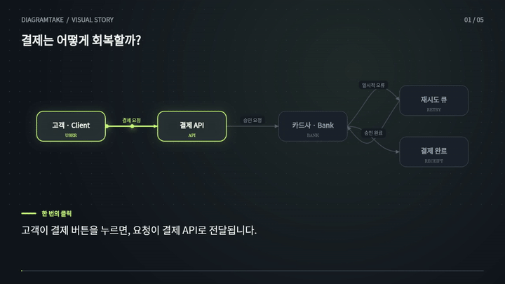
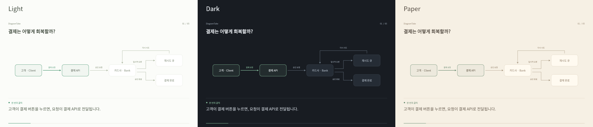

# DiagramTake

## 다이어그램에 이야기를 입히세요.

문장을 쓰고, 흐름을 고르고, 짧은 설명 영상으로 내보내세요.



복잡한 그림을 한 번에 보여주면 설명하는 사람도, 듣는 사람도 길을 잃기 쉽습니다. DiagramTake는 한 문장에 하나의 장면을 연결합니다. 결제 재시도, 서비스 구조, 제품 온보딩, 수업 자료를 움직이는 이야기로 만들 수 있습니다.

### 바로 시작하기

```sh
node server.js
```

http://localhost:5173 을 여세요. Node.js 20 이상이면 됩니다. 설치할 패키지나 API 키는 없습니다.

1. 예제의 재생 버튼을 누릅니다.
2. 왼쪽에서 장면을 선택하고 오른쪽에서 문장을 고칩니다.
3. 그림의 노드를 클릭해 강조하고, 움직일 연결선을 선택합니다.
4. 선 그리기·흐르는 점·펄스·등장·카메라 집중 중 효과를 고르고 강도와 속도를 정합니다.
5. Export에서 WebM 영상 또는 PNG 이미지를 저장합니다.

직접 녹음한 오디오도 추가할 수 있습니다. 영상 처음부터 함께 재생되며, 장면 길이는 직접 조절합니다.

### 손에 남는 결과물

- 편집 가능한 문장 카드, 복제·순서 변경·실행 취소
- 다섯 가지 효과와 장면별 속도·강도 조절
- 분기 포트와 왕복 우회선으로 정리한 연결, 부드러운 카메라 이동
- 재생·정지·탐색 타임라인
- 브라우저 자동 저장과 프로젝트 JSON 열기·저장
- 720p WebM 영상과 PNG 이미지
- 계정·업로드·유료 API 없이 내 기기에서 처리

### 분위기를 고르세요

상단 Theme에서 Light · Dark · Paper를 고를 수 있습니다. 편집기와 미리보기, PNG·영상 출력에 같은 테마가 적용되고 프로젝트에도 저장됩니다. 이전 버전 프로젝트는 Light로 열립니다.



[12초 Dark 예제](themes/dark-story.mp4)

### 알아두기

도형 입력은 문서에 안내한 작은 Mermaid-style 문법만 지원하며, 전체 Mermaid 호환 도구는 아닙니다. 오디오는 프로젝트 JSON에 포함되지 않으므로 프로젝트를 다시 열면 원본 음원을 다시 추가하세요. WebM 출력 중에는 탭을 열어두세요. 예제 MP4/GIF는 같은 장면 데이터와 렌더러를 Node와 FFmpeg로 렌더한 자료이며, 앱의 MP4 출력 기능은 아닙니다.

[전체 사용법과 기여 안내](../README.md) · [예제 영상](payment-retry.mp4) · [예제 프로젝트](../examples/payment-retry.json)
